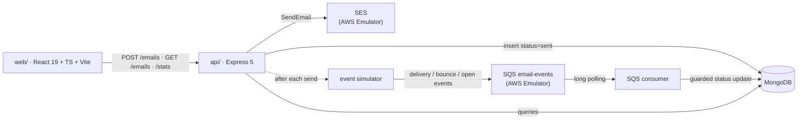

# email-delivery-tracker

Tracks what happens to every email a notification app sends — sent, delivered, bounced, opened — and shows it in a live dashboard.

**Live demo:** https://email-delivery-tracker.vercel.app (runs entirely in the browser with [MSW](https://mswjs.io): no backend, synthetic data).

All data is synthetic. The fictitious app sends through Amazon SES; SES and SQS run in the [official AWS Emulator](https://docs.aws.amazon.com/emulator/latest/userguide/getting-started.html), so the whole project runs locally at zero cost.

## Architecture



| Layer | Technology |
|---|---|
| API | Node 24, Express 5, TypeScript (runs `.ts` natively, no build step) |
| AWS | SES + SQS in the official AWS Emulator, SDK v3 |
| Data | MongoDB 8 |
| Dashboard | React 19, TypeScript, Vite, plain CSS |
| Quality | Vitest, Supertest, Testing Library, MSW, oxlint, ESLint, Prettier |
| CI | GitHub Actions (API with a real MongoDB service, web) |

## Features

- `POST /emails` sends through SES and stores the message as `sent`. If SES fails nothing is stored (`502`).
- Events use the SES event format and move a message through `sent → delivered | bounced` and `delivered → opened`.
- `GET /emails` filters by status, recipient substring and date range; `GET /emails/stats` returns counts per status.
- The dashboard has clickable status cards, debounced filters, loading/empty/error states, 5 s auto-refresh and a form to send an email.
- Recipients drive the simulator so every state can be tried: `bounce@…` bounces, `unopened@…` is delivered but never opened, anything else is delivered and opened.

## Run it locally

Requirements: Node 24+, Docker.

```bash
docker compose up -d                                   # MongoDB + AWS Emulator
sed "s|<HOME>|$HOME|g" .env.example > api/.env         # point the SDK at the emulator
(cd api && npm ci && npm run dev)                      # API on :3000
(cd web && npm ci && npm run dev)                      # dashboard on :5173
```

Open http://localhost:5173 and send an email to `bounce@example.com`: it goes from *Sent* to *Bounced* in about a second.

Tests and lint:

```bash
cd api && MONGODB_URI=mongodb://localhost:27017/etd npm test && npm run lint   # without MONGODB_URI the Mongo tests are skipped
cd web && npm test && npm run lint && npm run build
```

The public demo is the same dashboard built with `npm run build:demo` (`VITE_DEMO=true`): MSW answers the requests in the browser and imitates the event simulator.

## Technical decisions

- **Official AWS Emulator instead of LocalStack.** LocalStack Community now requires an account and a token; the emulator needs neither. It only runs natively on Linux, so on macOS it runs in Docker (`emulator/Dockerfile` installs the RPM).
- **A simulator fills a gap.** The emulator accepts `SendEmail` and SQS but does not publish SES events (delivery, bounce, open) to SNS/SQS. A small simulator publishes them to the queue in the real SES format, so the consumer is the code that would run against real AWS. It is removed when the emulator supports the events.
- **SQS standard queues don't guarantee order.** A `delivered` event can arrive after `opened`. `applyStatus` is a guarded update (`$in` the allowed previous states), so a late event can't move a message backwards.
- **At-least-once delivery handled on both sides.** The consumer deletes a message from the queue only after the update succeeded; if MongoDB fails SQS redelivers. Repeated events are harmless because transitions are guarded.
- **Dependency injection instead of mocking modules.** `createApp({ send, store })` lets the API tests run without AWS or MongoDB. Only the store tests use a real MongoDB (also in CI).
- **SDK v3 quirks with the emulator.** `disableHostPrefix`, and SQS `useQueueUrlAsEndpoint: false`: the emulator returns a queue URL on the real AWS host, and without that option the SDK would send the call to AWS. Documented in `AGENTS.md`.
- **SES identity verification is eventually consistent.** Sending right after `CreateEmailIdentity` can fail with `MessageRejected`; sending retries 5 × 200 ms.
- **Dashboard without extra libraries.** No router, state or UI library: native `<details>`, form validation and `Intl`. MSW serves the same handlers to the tests and to the public demo.

## What I would do differently in production

- Real SES event publishing (configuration set → SNS → SQS) and no simulator.
- A dead-letter queue for events that keep failing, plus idempotency by event id.
- Pagination with a cursor instead of `limit` and an index on `(status, sentAt)`; today's list is capped at 200.
- Push updates (SSE) instead of polling every 5 s.
- Authentication on the API and rate limiting on `POST /emails`.
- Run the integration tests against the emulator in CI (today CI uses test doubles for AWS and a real MongoDB).

## License

[MIT](LICENSE)
